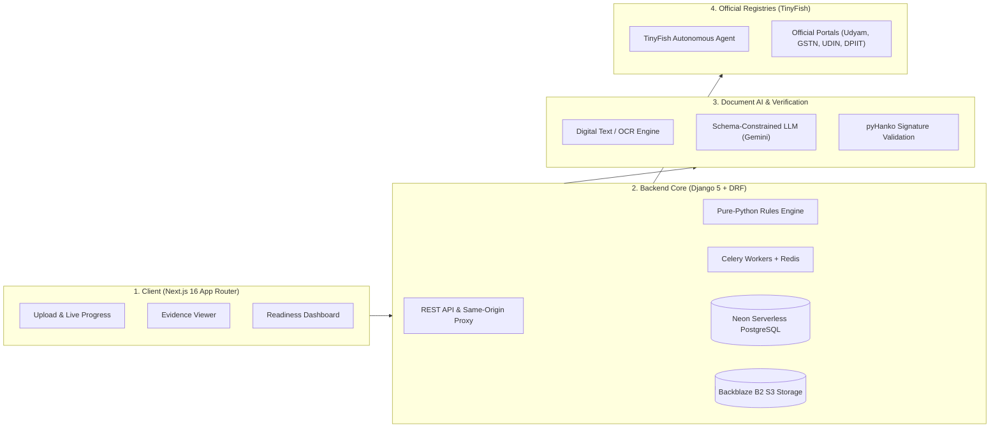
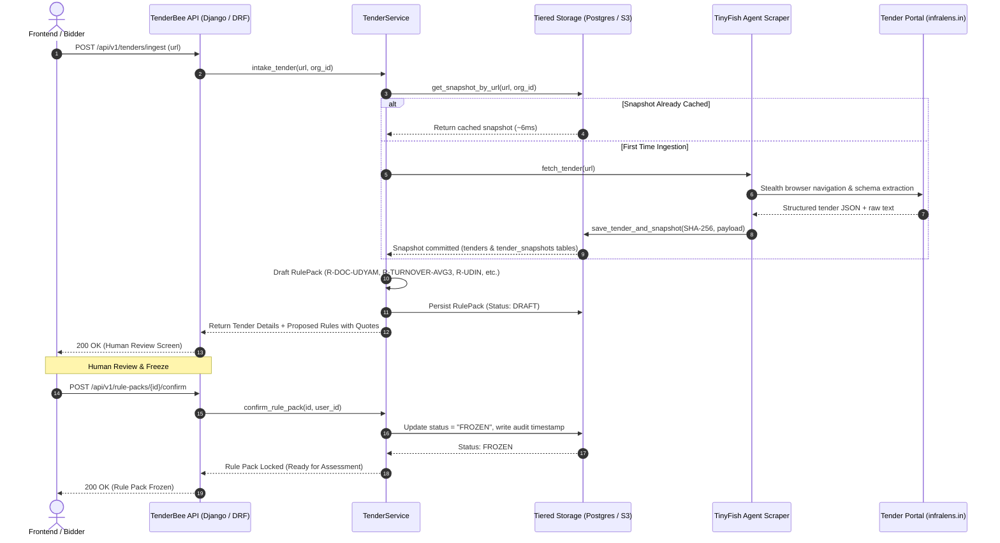

<div align="center">
  
  <h1>TenderBee</h1>
  <p><strong>Deterministic Tender Verification, Intelligent Intake & Proposal Platform</strong></p>

  <p>
    <a href="https://tenderbee.vercel.app"></a>
    <a href="https://tenderbee-1.onrender.com/api/health/"></a>
    <a href="#"></a>
    <a href="#"></a>
    <a href="#"></a>
    <a href="#"></a>
  </p>
</div>

---

> **"AI extracts. Deterministic rules decide. Official sources confirm."**
> 
> *TenderBee eliminates guesswork, hallucination, and disqualified bids from government (GeM, CPPP, State Portals) and enterprise procurement.*

---

## Live Deployments

* **Web Application (Frontend)**: [https://tenderbee.vercel.app](https://tenderbee.vercel.app)
* **Core API (Backend)**: [https://tenderbee-1.onrender.com](https://tenderbee-1.onrender.com)
* **API Health Check**: [https://tenderbee-1.onrender.com/api/health/](https://tenderbee-1.onrender.com/api/health/)
* **Interactive API Schema**: [https://tenderbee-1.onrender.com/api/schema/](https://tenderbee-1.onrender.com/api/schema/)

---

## Core Modules

TenderBee organizes the procurement lifecycle into three integrated modules, all operating on a single, deterministic source of truth:

1. **Find**:
   - Automated tender discovery across public procurement portals (GeM, CPPP, State e-Procurement).
   - Real-time parameter extraction, closing deadlines, EMD fees, and eligibility fit scoring.
2. **Verify**:
   - Cryptographic PDF signature verification (`pyHanko`) and tamper-proof SHA-256 checksums.
   - Schema-constrained Document AI extraction (financial turnover, technical experience, MSME status).
   - Pure-Python deterministic rules engine evaluation with side-by-side evidence inspection.
   - Authoritative registry cross-checks (GSTN, Udyam MSME, ICAI UDIN).
3. **Prepare**:
   - Proposal drafting, required checklist packaging, and bid-readiness validation prior to submission.
   - Automated discrepancy detection to prevent technical disqualification.

---

## Technical Architecture Overview



---

## Architectural Invariants (By the Numbers)

| Metric | Target | Rationale |
| :---: | :---: | :--- |
| **7** | **Pipeline Stages** | Rigorous step-by-step verification pipeline from file ingestion to user verdict. |
| **5** | **Verification Layers** | File integrity, cryptographic signature, OCR/data extraction, rule validation, registry confirmation. |
| **0** | **LLM Pass/Fail Decisions** | The LLM **never** decides compliance or eligibility; it only extracts values into strict JSON schemas. Pass/fail is strictly deterministic. |
| **4** | **Verdicts (No Silent Accept)** | Explicit outcomes: `Pass`, `Fail`, `Discrepancy`, `Incomplete`. |

---

## The Seven Pipeline Stages

```text
 ┌─────────────┐    ┌─────────────┐    ┌─────────────┐    ┌─────────────┐
 │   Stage 1   │ -> │   Stage 2   │ -> │   Stage 3   │ -> │   Stage 4   │
 │ Upload &    │    │ OCR & Text  │    │ LLM Value   │    │ Validation  │
 │ Integrity   │    │ Extraction  │    │ Extraction  │    │ Rules       │
 └─────────────┘    └─────────────┘    └─────────────┘    └─────────────┘
  (File Checks)      (Extract Text)     (AI Extract)       (Rule Engine)
         │
         v
 ┌─────────────┐    ┌─────────────┐    ┌─────────────┐
 │   Stage 5   │ -> │   Stage 6   │ -> │   Stage 7   │
 │ Profile &   │    │ External    │    │ Verdict &   │
 │ Tender Fit  │    │ Verification│    │ Evidence    │
 └─────────────┘    └─────────────┘    └─────────────┘
  (Profile Fit)      (TinyFish API)     (User Sign-off)
```

1. **Upload & Integrity**: Checksum calculation (SHA-256), cryptographic signature validation (`pyHanko`), and heuristic prompt-injection screening.
2. **OCR & Text Extraction**: High-fidelity text extraction from PDFs, balance sheets, and scanned certificates.
3. **LLM Extraction**: Schema-constrained entity extraction (Google Gemini) enforcing strict JSON structures.
4. **Validation Rules**: Pure-Python rule evaluation against extracted facts (turnover thresholds, experience years, EMD clauses).
5. **Profile + Tender Checks**: Bidder capability matching against specific tender eligibility matrices.
6. **External Verification**: Authoritative lookups via TinyFish against government databases (GSTN active status, Udyam MSME classification, ICAI UDIN).
7. **Verdict & Evidence**: Final audit trail with side-by-side evidence snippet citations for human confirmation.

---

## Workflow: Tender Intake & Rule Pack Freezing



---

## Technology Stack

| Category | Component | Purpose |
| :--- | :--- | :--- |
| **Frontend** | Next.js 16 (App Router), TypeScript, TailwindCSS 4 | Evidence viewer, live progress, review screens, readiness matrix |
| **Backend API** | Django 5.x, Django REST Framework | Multi-tenant domain services, JWT auth, RESTful APIs, OpenAPI |
| **Rules Engine** | Pure-Python (`backend/engine`) | Isolated, deterministic evaluation; zero database/network dependencies |
| **Async Tasks** | Celery, Redis | Heavy PDF processing, async intake, background verification pipeline |
| **Database** | Neon Serverless PostgreSQL | Relational storage, connection pooling, immutable audit logs |
| **Object Storage** | Backblaze B2 (S3-Compatible via `boto3`) | Tender PDFs, bidder certificates, and extracted document page artifacts |
| **Document AI** | Google Gemini 2.0 Flash REST API | Schema-constrained JSON entity extraction without hallucination |
| **Signatures & OCR** | pyHanko, PyMuPDF, Tesseract OCR | Cryptographic signature validation and scanned document extraction |
| **Web Agents** | TinyFish SDK & APIs | Headless browsing, dynamic portal scraping, and registry lookups |
| **Deployment** | Vercel (Frontend) + Render (Backend) | Production hosting with zero-config blueprints |

---

## Production Deployment (Vercel & Render)

TenderBee is configured for full-stack production deployment:
* **Frontend on Vercel**: Configured via [`frontend/vercel.json`](frontend/vercel.json) and Next.js server-side backend proxy.
* **Backend on Render**: Configured via [`render.yaml`](render.yaml) Blueprint, [`backend/build.sh`](backend/build.sh), WhiteNoise static compression, and Gunicorn WSGI.

For complete deployment instructions, see the dedicated [**DEPLOYMENT.md**](DEPLOYMENT.md) guide.

---

## Neon Serverless Database Configuration

TenderBee connects to Neon serverless PostgreSQL using a dual-connection architecture:

> **Database Connection Rules:**
> - **Runtime Application**: Connects to the **pooled connection string** (`DATABASE_URL`) to support serverless autoscaling and connection pooling (`conn_max_age = 600`).
> - **Database Migrations**: Migrations **must** run against the **direct session string** (`DIRECT_URL`) because schema alterations require session-level locking.

```bash
# Execute migrations using DIRECT_URL
python manage.py migrate
```

---

## Local Development Quickstart

### 1. Prerequisites
- Python 3.11 or 3.12
- Node.js 20+ and npm
- (Optional) Tesseract OCR for scanned PDF evaluation

### 2. Backend Setup
```bash
cd backend
python -m venv venv
# On Windows: .\venv\Scripts\activate | On macOS/Linux: source venv/bin/activate
pip install -r requirements.txt
python manage.py migrate
python manage.py runserver
```
Backend API will be live at `http://127.0.0.1:8000/`.

### 3. Frontend Setup
```bash
cd frontend
npm install
npm run dev
```
Frontend web application will be live at `http://localhost:3000/`.

---

## Local Document Extraction CLI

From the repository root, extract text and locally detected fields from PDFs:

```powershell
python scripts\extract_documents.py "path\to\application.pdf" --output .\extraction.json
```

For schema-constrained output matching your tender criteria:

```powershell
python scripts\extract_documents.py `
  --schema samples\application_extraction.schema.json `
  --application bidder-udyam.pdf `
  --application ca_turnover_certificate=bidder-turnover.pdf `
  --output .\extracted.json `
  --evidence .\evidence.json
```

---

## Security & Defense-in-Depth

- **Tenant Isolation**: Every database query is strictly scoped to the authenticated organization's tenant context via `TenantContextMiddleware`.
- **Prompt Injection Screening**: Suspicious document uploads matching adversarial injection heuristics are automatically withheld from LLM extraction and flagged for human review.
- **Cryptographic Digest Integrity**: PDF SHA-256 digests are re-computed and validated before any evidence is processed or signed.
- **Strict Content Security Policy (CSP)**: Hardened headers with frame protection, HTTPS connection restrictions, and strict origin validation.

---

<div align="center">
  <sub>Built with precision for enterprise and government procurement. © 2026 TenderBee.</sub>
</div>
